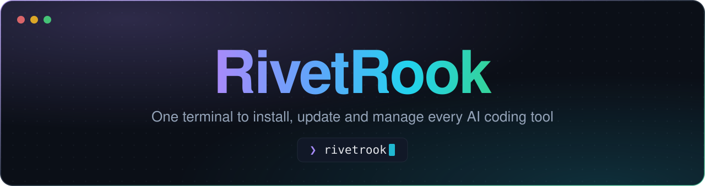

<p align="center">
  
</p>

<p align="center">
  <b>Instale, atualize e gerencie todas as ferramentas de IA para programação — num só terminal.</b>
</p>

<p align="center">
  
  
  
  
</p>

<p align="center">
  <a href="README.md">English</a> &nbsp;·&nbsp; <b>Português</b>
</p>

<br>

> [!TIP]
> **Instale com o seu agente de IA.** Cole no Claude Code, Codex, Gemini CLI, Cursor ou em qualquer outro agente:
>
> ```text
> Instale o RivetRook: https://github.com/paulocarinhena/RivetRook
> ```
>
> 🤖 *Agentes de IA: o passo a passo de instalação está em [`INSTALLATION.md`](INSTALLATION.md).*

<p align="center">
  
</p>

## ✦ Destaques

<table>
  <tr>
    <td width="33%" valign="top"><b>⚡ Um menu, 23 ferramentas</b><br><sub>Claude Code, Codex, Gemini CLI, Cursor, Zed e muito mais — instalar, atualizar e remover a um número de distância.</sub></td>
    <td width="33%" valign="top"><b>🔍 Sempre atualizado</b><br><sub>Detecta em paralelo a versão instalada e a última publicada, marcando o que tem atualização.</sub></td>
    <td width="33%" valign="top"><b>🔁 Atualiza a si mesmo</b><br><sub>A cada início, compara com o GitHub e oferece a versão nova — via <code>git pull</code> ou download validado.</sub></td>
  </tr>
  <tr>
    <td valign="top"><b>🖥️ Multiplataforma de verdade</b><br><sub>Windows, macOS e Linux (Debian, Fedora, Arch), usando <code>winget</code>, <code>brew</code>, <code>apt</code>, <code>dnf</code>, <code>pacman</code> e <code>npm</code>.</sub></td>
    <td valign="top"><b>🔑 Chaves de API</b><br><sub>Configura e persiste as chaves das ferramentas que precisam delas, direto pelo menu.</sub></td>
    <td valign="top"><b>🧩 Extensível</b><br><sub>Cada ferramenta é só uma entrada no <code>config.json</code>. Sem dependências: só a biblioteca padrão do Python.</sub></td>
  </tr>
</table>

## 🚀 Instalação

**Com um agente de IA** — use a frase da dica acima. O agente segue o [`INSTALLATION.md`](INSTALLATION.md), deixa o comando `rivetrook` disponível no terminal e confere a instalação.

**Manualmente:**

```sh
git clone https://github.com/paulocarinhena/RivetRook.git
python3 RivetRook/src/RivetRook.py        # Windows: python RivetRook\src\RivetRook.py
```

Para abrir com dois cliques, use `src/Execute_RivetRook.bat` (Windows) ou `src/Execute_RivetRook.sh` (Linux/macOS). Para ter o comando `rivetrook` em qualquer terminal, siga o [`INSTALLATION.md`](INSTALLATION.md).

> **Requisitos:** Python 3.8+. O Node.js 20+ é instalado automaticamente na primeira execução, se faltar.

## 🧭 Como usar

Ao abrir, o RivetRook pergunta o idioma, oferece a própria atualização (se houver), verifica o Node.js e mostra o estado de todas as ferramentas. Escolha uma ou várias pelo número ou nome — `3`, `claude` ou `1,3,5` — e depois a ação: **instalar**, **atualizar**, **desinstalar** ou **configurar a chave de API**. `Enter` sem nada sai.

<details>
<summary><b>Legenda dos ícones</b></summary>
<br>

| Ícone | Significado |
|:-----:|-------------|
| `●` | Instalado |
| `◐` | Instalado, mas só disponível via perfil de shell |
| `○` | Não instalado |
| `↑ x → y` | Atualização disponível |
| `⚷` | Chave de API — verde: configurada · amarela: pendente |

</details>

## 🧰 Ferramentas suportadas

<table>
<tr><th align="left">CLIs de IA</th><th align="left">IDEs</th></tr>
<tr><td valign="top">

| Ferramenta | Autor |
|------------|-------|
| **claude** | Anthropic |
| **codex** | OpenAI |
| **geminicli** | Google |
| **agy** | Google · Antigravity |
| **copilot** | GitHub / Microsoft |
| **cursor-agent** | Anysphere |
| **opencode** | SST / Dax |
| **pi** | Earendil Works |
| **kilocode** | Kilo Code |
| **cline** | Cline Bot |
| **qwen** | Alibaba Cloud |
| **kimi** | Moonshot AI |
| **grok** | xAI |
| **groq** | Groq |
| **openhands** | All Hands AI |
| **forgecode** | Forge |
| **crush** | Charmbracelet |

</td><td valign="top">

| IDE | Autor |
|-----|-------|
| **cursor** | Anysphere |
| **zed** | Zed Industries |
| **windsurf** | Codeium / Windsurf |
| **antigravity** | Google |
| **trae** | ByteDance / Trae |
| **opencode-desktop** | Anomaly |

</td></tr>
</table>

Falta alguma? Adicionar é editar o `config.json` — veja abaixo.

## 📚 Referência

<details>
<summary><b>Atualização automática</b></summary>
<br>

Ao iniciar, o RivetRook compara o seu <code>__version__</code> com o publicado na branch `main` do GitHub. Se houver uma versão mais nova, ele oferece atualizar e reiniciar:

- **Clone git** deste repositório → `git pull --ff-only`
- **Cópia avulsa** → baixa `src/RivetRook.py` e `src/config.json`, valida os dois e só então substitui os arquivos (um `config.json` passado como argumento nunca é alterado)

Para desativar, defina a variável de ambiente `RIVETROOK_NO_UPDATE=1`.

</details>

<details>
<summary><b>Chaves de API</b></summary>
<br>

Para as ferramentas que precisam de chave, o RivetRook:

- detecta se a chave já está configurada;
- pede a chave logo após a instalação;
- salva no arquivo de configuração da própria ferramenta (ex.: `~/.claude.json`);
- persiste como variável de ambiente nos arquivos de shell (`.bashrc`, `.zshrc`, `.profile`) no Linux/macOS.

Para configurar depois, escolha a ferramenta no menu e a opção **4 – Configurar API key**.

</details>

<details>
<summary><b>Adicionar uma ferramenta</b></summary>
<br>

Cada ferramenta é uma entrada em `src/config.json`, na seção `"tools"` ou `"ides"` (a ordem do menu segue a ordem do JSON):

```jsonc
"minha-ferramenta": {
  "author": "Empresa",
  "description": "Descrição em português",
  "description_en": "Description in English",
  "install": {
    "all": "npm install -g minha-ferramenta",
    "windows": "winget install -e --id Empresa.Ferramenta",
    "macos": "brew install minha-ferramenta",
    "linux": { "debian": "apt-get install -y minha-ferramenta", "default": "npm install -g minha-ferramenta" }
  },
  "upgrade": { "all": "npm install -g minha-ferramenta@latest" },
  "uninstall": { "all": "npm uninstall -g minha-ferramenta" },
  "run": "minha-ferramenta"
}
```

| Campo | Descrição |
|-------|-----------|
| `author`, `description`, `description_en` | Autor e descrições exibidos no menu |
| `install` · `upgrade` · `uninstall` | Comandos por plataforma: `all`, `windows`, `macos`, `linux` (ou `debian`/`fedora`/`arch`/`default`). Sem `uninstall`, ele é deduzido do `install` para `winget`, `brew`, `npm`, `bun`, `apt-get`, `dnf`/`yum` e `pacman` |
| `run` | Binário principal, usado para detectar a instalação |
| `version_cmd` · `version_regex` | Comando e regex (grupo 1) para ler a versão instalada |
| `latest` | Onde buscar a última versão: `npm`, `pypi`, `brew_cask`, `brew_formula`, `github` (`dono/repo`) ou `url` + `regex`. Deduzido automaticamente de instalações via `npm`, `bun` e `brew` |
| `skip_version_probe` | Não executa o binário para detectar a versão (apps gráficos) |
| `needs_git` | Exige Git no Windows |
| `path_entry` | Pasta a adicionar ao `PATH` após instalar |
| `configure` | Chave de API: `env_var`, `settings_file`, `settings_key`, `prompt` |

Para contribuir com uma ferramenta nova, veja o [`CONTRIBUTING.md`](CONTRIBUTING.md).

</details>

<details>
<summary><b>Gerenciadores de pacotes por plataforma</b></summary>
<br>

| Plataforma | Gerenciadores |
|------------|---------------|
| Windows | `winget`, PowerShell 7 (`pwsh`), `npm` |
| macOS | `brew`, `npm`, `curl` |
| Debian / Ubuntu | `apt`, `npm`, `curl` |
| Fedora / RHEL | `dnf`, `npm`, `curl` |
| Arch | `pacman`, `npm`, `curl` |

</details>

<details>
<summary><b>Aviso legal</b></summary>
<br>

O RivetRook é apenas um facilitador de instalação: ele executa os comandos oficiais publicados por cada fabricante (`npm`, `winget`, `brew`, `apt`…), exatamente como você faria no terminal. Ele não modifica, redistribui nem se apropria de nenhum software de terceiros, e não tem afiliação com as empresas listadas — todas as ferramentas pertencem aos seus respectivos donos.

</details>

## 🤝 Contribuindo

Bugs, ideias e novas ferramentas são bem-vindos — veja o [`CONTRIBUTING.md`](CONTRIBUTING.md).

<br>

<p align="center">
  <sub>Feito com 💜 por <a href="https://github.com/paulocarinhena">Paulo Carinhena</a> · Licença <a href="LICENSE">GPL-3.0</a></sub>
</p>
